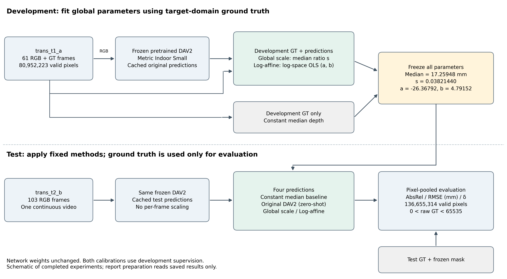
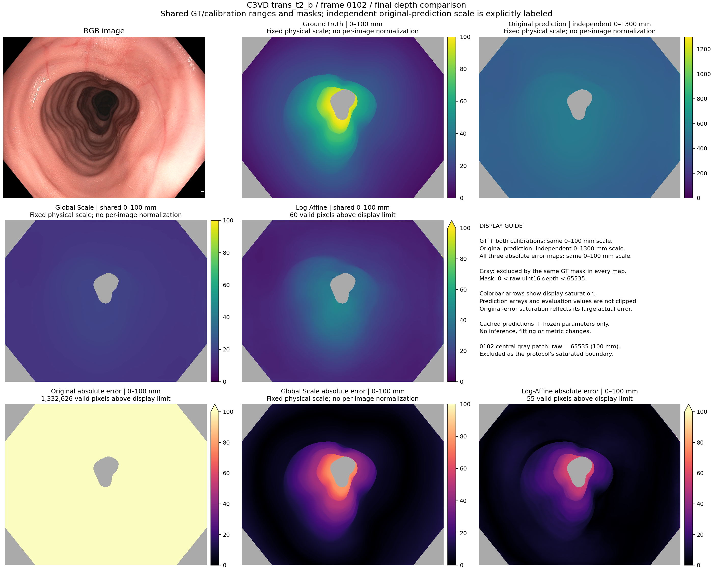
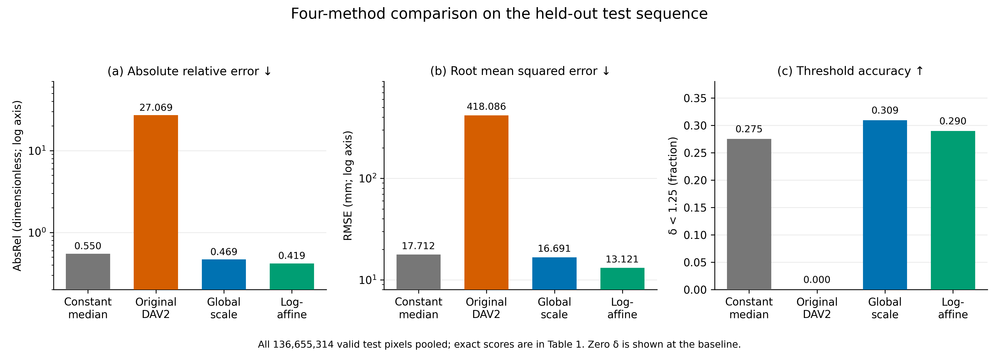
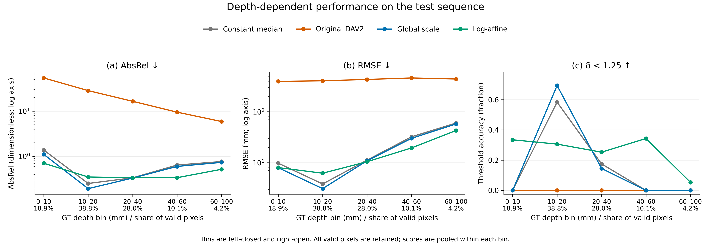
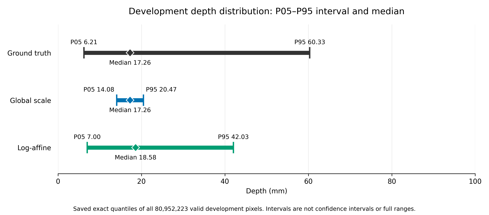

# General-Purpose Monocular Depth Estimation for Endoscopic Images: Evaluation and Target-Domain Calibration

## 1. Title and Team Information

**Module:** BN5211 Medical Robotics Intelligence  
**Project:** Depth Estimation from Monocular or Stereo Endoscopic Images  
**Group:** [GROUP NUMBER]  
**Team members:** [FULL NAME — STUDENT ID; repeat for all members]  
**Institution:** [INSTITUTION]  
**Submission date:** [DATE]

### Abstract

Monocular depth estimation could support spatial perception in endoscopic robotics, but a pretrained model's depth structure and absolute scale may transfer differently. We evaluated Depth Anything V2 Metric Indoor Small on two sequences from the Colonoscopy 3D Video Dataset (C3VD), using 61 development frames and 103 test frames. The network remained frozen. Alongside a constant-depth baseline, we compared original pretrained inference with a development-supervised global scale correction and a development-supervised log-affine correction. All test scores pooled the same valid pixels. Original inference showed severe scale mismatch: AbsRel was 27.0687 and RMSE was 418.0856 mm. Global scale calibration reduced these to 0.4685 and 16.6907 mm. Log-affine calibration expanded the compressed development depth range and further reduced test AbsRel to 0.4191 and RMSE to 13.1206 mm, while threshold accuracy decreased from 0.3092 to 0.2897. Depth-stratified analysis located this trade-off mainly in the 10–20 mm range. Calibration recovered useful information, but substantial depth-dependent and local errors remained. These phantom-sequence results do not establish clinical generalization.

## 2. Background

Depth provides the geometric context needed to interpret an endoscopic view. In medical robotics, estimates of camera-to-surface distance can inform spatial awareness, surface reconstruction, and navigation. Colonoscopy is a demanding setting for quantitative evaluation because dense depth ground truth is difficult to acquire alongside optical video. C3VD addresses part of this problem through recordings of physical colon models paired with registered, rendered depth [1].

A monocular image does not uniquely determine scene geometry. Learned estimators combine global scene information and local visual cues, while absolute scale remains ambiguous [2]. Large-scale pretraining broadens the range of visual patterns available to a model, but performance on a new dataset still requires measurement. Work on mixed-dataset training explicitly studies transfer across datasets with different depth ranges and annotation conventions [3].

Depth Anything V2 uses synthetic supervision and pseudo-labeled real images to build a general-purpose depth representation [4]. The availability of metric-depth checkpoints makes it possible to test direct deployment without target-domain network training. However, an indoor metric checkpoint is not evidence of accurate millimetre-scale endoscopic depth. Its spatial ordering, scale, and contrast can fail in different ways.

This project asks three practical questions: how well does a frozen checkpoint perform on a small endoscopic benchmark; how much of its error can one development-derived scale factor remove; and can a standard log-affine mapping address compressed depth variation? The contribution is a controlled empirical comparison and error analysis. Neither calibration is proposed as a new algorithm. Both use target-domain depth supervision and are distinguished throughout from original zero-shot inference.

## 3. Methods

### 3.1 Data, split, and depth representation

C3VD pairs optical recordings from a clinical colonoscope viewing high-fidelity physical colon models with depth rendered from registered 3D geometry [1]. The RGB images are therefore phantom recordings, rather than wholly synthetic images or patient examinations. We used the supplied `trans_t1_a` sequence for development (61 frames) and `trans_t2_b` for testing (103 frames), at 1350 × 1080 pixels. These are different sequences of the same broad model setting; the split does not demonstrate independence across anatomy, institutions, or patients.

The official depth representation is camera-frame Z depth, clamped to 0–100 mm and linearly encoded in 16-bit grayscale [5]. For raw code $r$, decoding is

$$
g_{\mathrm{mm}}=r\frac{100}{65535}.
$$

The frozen project protocol, `c3vd-interior-v1`, selects $0<r<65535$. It excludes zero depth, for which ratio metrics are undefined, and the saturated upper encoding boundary. This mask is a project convention, not a required official C3VD benchmark mask. No additional region crop, appearance-based mask, or prediction-dependent rejection was used. There were 80,952,223 valid development pixels and 136,655,314 valid test pixels; approximately 9.00% of test pixels were excluded. Every method used the same mask.

### 3.2 Frozen pretrained inference

We used `depth-anything/Depth-Anything-V2-Metric-Indoor-Small-hf`, fixed at revision `8078d68a9c75a972131914f6afd0c1723be0da7f`. This is the Small indoor metric checkpoint, fine-tuned by its authors using Hypersim, with a DINOv2 backbone and DPT depth head [6]. In this project, weights were unchanged and there was no training or fine-tuning.

Images were processed with the checkpoint's Transformers image processor. Floating-point depth outputs were resized to the native image resolution with bicubic interpolation, following the model card [6]. The documented metre output was multiplied by 1000 to obtain millimetres [7]. No display-normalized image was used as numerical depth. Original predictions were retained as float32 arrays. In this report, *zero-shot* denotes applying this released checkpoint without fitting to the project's development depth labels; it does not mean the checkpoint was never trained with metric supervision.

### 3.3 Constant-median-depth baseline

The baseline predicts one constant at every pixel:

$$
\hat d_i^{\mathrm{median}}=\operatorname{median}_{j\in\mathcal V_{\mathrm{dev}}}g_j
=17.25947966735332\ \mathrm{mm}.
$$

The median pooled all valid development GT pixels, using a histogram of the uint16 codes. It was not the median of frame medians. This development-supervised baseline tests whether image-dependent inference adds value beyond a central depth estimate. It uses no test GT for fitting.

### 3.4 Development-supervised global scale calibration

The first correction uses the predeclared pooled-median ratio,

$$
s=\frac{\operatorname{median}_{\mathcal V_{\mathrm{dev}}}(g)}
        {\operatorname{median}_{\mathcal V_{\mathrm{dev}}}(\hat d)},
\qquad \hat d_i^{\mathrm{scale}}=s\hat d_i.
$$

The development GT and prediction medians were 17.25947966735332 and 451.6485900878906 mm, respectively, giving $s=0.03821439952684151$. One frozen factor was applied to every test frame. This is supervised post-processing using development GT, not a fully zero-shot method or test-image median scaling. Multiplication was performed in float64 and the result stored transiently as float32, preserving the completed experiment's implementation.

### 3.5 Development-supervised log-affine calibration

To adjust depth contrast as well as scale, we fitted

$$
\hat d_i^{\mathrm{log}}=d_0\exp\left(a+b\log(\hat d_i/d_0)\right),
\qquad d_0=1\ \mathrm{mm}.
$$

Writing the logarithm relative to $d_0$ makes the unit convention explicit. Equivalently, the implementation applies `exp(a + b * log(prediction_mm))` and returns millimetres. The parameters minimize

$$
\sum_{j\in\mathcal V_{\mathrm{dev}}}
\left[\log(g_j/d_0)-a-b\log(\hat d_j/d_0)\right]^2.
$$

All valid development pixels had equal weight. Float64 centered sufficient statistics were accumulated frame by frame; with $x=\log(\hat d/d_0)$ and $y=\log(g/d_0)$, ordinary least squares gives $b=S_{xy}/S_{xx}$ and $a=\bar y-b\bar x$. The fitted values were

$$
a=-26.367917618101938,\qquad b=4.791517002825514.
$$

Parameters were saved before test evaluation and applied globally without refitting. Inputs had to be finite and positive; application retained float64 precision. Neither calibration clipped predictions, normalized individual images, nor changed the network. The log-space objective does not directly optimize any of the three reported metrics.

**Figure 1.** Completed experimental workflow. Development GT fits the constant baseline and both calibrations; the frozen network supplies image-dependent predictions. Parameters are then fixed for test evaluation. Test GT contributes only to the evaluation path. Original DAV2 is zero-shot with respect to project development labels; the calibrations are development-supervised.

### 3.6 Evaluation and diagnostic analysis

For valid-pixel set $\mathcal V$, size $N$, GT $g_i$, and prediction $p_i$, we report

$$
\mathrm{AbsRel}=\frac1N\sum_{i\in\mathcal V}\frac{|p_i-g_i|}{g_i},\qquad
\mathrm{RMSE}=\sqrt{\frac1N\sum_{i\in\mathcal V}(p_i-g_i)^2},
$$

$$
\delta_{1.25}=\frac1N\sum_{i\in\mathcal V}
\mathbf1\!\left[\max(p_i/g_i,g_i/p_i)<1.25\right].
$$

AbsRel and δ are dimensionless; RMSE is in mm. The inequality is strict. Formal scores pool valid pixels across all frames, using float64 sums. In particular, pooled RMSE is not an average of frame RMSEs. Selected GT and predictions must be finite and positive; unfavorable predictions are not filtered out.

Existing diagnostics divide GT into fixed left-closed, right-open bins of [0,10), [10,20), [20,40), [40,60), and [60,100) mm. Each bin also pools pixels. Development structure is summarized by within-frame Pearson correlation on valid pixels; a constant GT or prediction produces an undefined value recorded separately. Frame distributions and threshold-pass transitions are descriptive. Correlated video frames and pixels are not treated as independent clinical samples.

### 3.7 Environment and reproducibility

Completed inference used an NVIDIA RTX 3060 Laptop GPU (6 GB), Python 3.13.5, PyTorch 2.11.0+cu126, CUDA 12.6, Transformers 4.57.6, NumPy 2.4.4, and Pillow 12.1.1. Inference used batch size one and float32 without autocast. Calibration and evaluation reused saved original predictions. Report graphics use Matplotlib 3.10.8 on CPU and read existing result summaries; report preparation performed no inference, fitting, or metric reevaluation. Frozen parameters, the protocol, complete-precision scores, and per-frame results remain available in the project outputs.

## 4. Experiments and Results

### 4.1 Qualitative comparison

Figure 2 reuses the corrected comparison for test frame 0102, the fixed last frame of the sequence. Earlier visual checks also used frames 0000 and 0051; these were chosen by position rather than metric rank. The comparison shows the original output at a much larger absolute scale and the limited variation after a single multiplicative correction. Log-affine calibration increases contrast but does not reproduce all local GT structure.

**Figure 2.** Fixed test frame 0102: RGB, GT, original DAV2, both calibrations, and their absolute error maps. GT and both calibrated predictions share viridis at 0–100 mm. Original prediction uses an explicitly separate 0–1300 mm scale; all error maps share magma at 0–100 mm. Gray denotes the same GT-excluded pixels in every map. Display saturation is marked and does not clip numerical predictions or scores. The central excluded GT component contains raw code 65535, the 100 mm encoding boundary. No per-image normalization is used.

### 4.2 Overall quantitative performance

Table 1 gives the formal pixel-pooled test scores. Original pretrained inference was worse than the constant baseline on all metrics. Global scale calibration improved all three baseline scores. Log-affine calibration achieved the lowest AbsRel and RMSE, while global scale retained the highest δ. Thus no method dominated the other calibrated method on all metrics.

**Table 1. Test sequence: 103 frames, 136,655,314 valid pixels.** Lower AbsRel and RMSE are better; higher δ is better. Bold indicates the best result per column. Both calibrations and the baseline use development GT; only original DAV2 is zero-shot with respect to that supervision.

| Method | AbsRel ↓ | RMSE (mm) ↓ | δ < 1.25 ↑ |
| --- | ---: | ---: | ---: |
| Constant median | 0.54988718 | 17.71215573 | 0.27518633 |
| Original Depth Anything V2 | 27.06870370 | 418.08559985 | 0.00000000 |
| Global scale calibration | 0.46851230 | 16.69069083 | **0.30924857** |
| Log-affine calibration | **0.41913838** | **13.12062839** | 0.28966559 |

Relative to global scale, log-affine reduced test AbsRel by 10.54% and RMSE by 21.39% (3.5701 mm), but reduced δ by 1.9583 percentage points. These are changes between frozen methods, not results of selecting test-specific parameters.

**Figure 3.** Formal test scores for all four methods. AbsRel and RMSE use clearly labeled logarithmic axes to accommodate the original model's much larger errors. δ uses a linear axis and is a fraction. Bar annotations are rounded; Table 1 retains eight decimal places. There are no inferential error bars because this experiment contains one continuous test sequence.

**Table 2. Development sequence results.** The calibrated rows describe performance on the data used for fitting and are not independent validation scores.

| Method | AbsRel ↓ | RMSE (mm) ↓ | δ < 1.25 ↑ |
| --- | ---: | ---: | ---: |
| Original Depth Anything V2 | 28.67227614 | 430.62626127 | 0.00000000 |
| Global scale calibration | 0.50868805 | 16.98462983 | 0.29631624 |
| Log-affine calibration | 0.36418687 | 11.36445892 | 0.43914866 |

### 4.3 Depth-dependent performance

Table 3 and Figure 4 expose differences hidden by aggregate scores. The 10–20 mm bin contains 38.76% of valid test pixels. Global scale performed strongly there, whereas log-affine increased both errors and substantially reduced δ. In contrast, log-affine reduced RMSE in the 40–60 and 60–100 mm bins. Effects in other bins were mixed: at 0–10 mm, AbsRel and δ improved while RMSE rose slightly; at 20–40 mm, RMSE and δ improved while AbsRel increased slightly.

**Table 3. Depth-stratified test comparison of the calibrations.** Each method cell lists AbsRel / RMSE (mm) / δ. Values are pooled within bins; full-precision results for all four methods are supplied in the accompanying tables.

| GT bin (mm) | Valid-pixel share | Global scale | Log-affine |
| --- | ---: | ---: | ---: |
| [0,10) | 18.91% | 1.10542 / 7.96384 / 0.00000093 | 0.70481 / 8.00171 / 0.33443 |
| [10,20) | 38.76% | 0.19351 / 3.08848 / 0.69297 | 0.35021 / 6.20210 / 0.30600 |
| [20,40) | 28.01% | 0.33172 / 10.91804 / 0.14507 | 0.33643 / 10.43310 / 0.25259 |
| [40,60) | 10.15% | 0.59932 / 30.04642 / 0.00000 | 0.33773 / 19.46602 / 0.34318 |
| [60,100) | 4.17% | 0.73669 / 57.52696 / 0.00000 | 0.51784 / 42.76225 / 0.05338 |

**Figure 4.** Pixel-pooled test performance in the fixed GT depth bins for all four methods. Tick labels include each bin's proportion of valid pixels. AbsRel and RMSE use logarithmic axes; δ is linear. The 10–20 mm penalty contrasts with improvements at greater depths. All bins use the frozen GT mask, and no large-error pixels are removed.

Far-depth underestimation remained substantial. Within 60–100 mm, mean GT was 76.10 mm, compared with predictions of 19.64 mm for global scale and 36.27 mm for log-affine; the latter underestimated 99.47% of pixels in this bin. Pixels with GT ≥40 mm represented only 14.31% of the valid population but contributed 82.38% of global-scale squared error and 66.59% of log-affine squared error.

### 4.4 Depth structure and distribution

All 61 development frames had positive original-prediction Pearson correlation with GT: mean 0.7837, median 0.7865, range 0.6201–0.8959. There were no undefined correlations. This supports an association with relative depth variation, despite poor absolute accuracy; it does not establish a learned geometric mechanism or pixelwise reliability.

The original development prediction median was approximately 26.17 times the GT median. After global scaling, the median matched GT but the central 90% depth interval was narrow. Log-affine expanded its P05–P95 width from 6.39 to 35.03 mm, still below GT's 54.12 mm. Its P95 remained too low and its median was slightly high (Table 4).

**Table 4. Exact pooled development depth quantiles (mm).** The intervals summarize the central 90% of valid-pixel depths, not the full range or statistical confidence.

| Depth source | P05 | Median | P95 |
| --- | ---: | ---: | ---: |
| Ground truth | 6.21194781 | 17.25947967 | 60.33417258 |
| Global scale | 14.07882023 | 17.25947952 | 20.46521759 |
| Log-affine | 7.00191592 | 18.58152590 | 42.03386409 |

**Figure 5.** Development depth distribution summarized by saved exact pooled quantiles. Lines span P05–P95 and diamonds mark medians on one shared depth axis. This is a quantile summary rather than an estimated density. Log-affine expands the compressed distribution but does not fully match GT. Values outside these intervals remain included in all formal metrics.

### 4.5 Threshold transitions, large errors, and frames

Pixelwise transitions directly locate the overall δ reduction. Global scale alone passed 29,304,468 pixels, while log-affine alone passed 26,628,349: a net loss of 2,676,119. The 10–20 mm bin lost 20,498,249 net passes, contributing −15.0000 percentage points to the overall change; gains in the other four bins offset most of this loss. In that bin, mean signed residual changed from +1.2706 to −0.8344 mm, while residual standard deviation increased from 2.8150 to 6.1457 mm. Smaller mean bias therefore coexisted with a wider error distribution and fewer threshold passes.

Log-affine absolute errors above 50 mm occupied 1.1930% of valid pixels and contributed 24.9109% of its squared error. Errors above 100 mm occurred at 3,958 pixels (0.002896%), all in the 0–10 mm GT bin, and contributed 1.1289% of squared error. The maximum absolute error was 1931.15 mm. These extreme errors were retained, although they did not alone dominate total RMSE. By comparison, the original model's absolute error exceeded 100 mm at every valid test pixel.

Log-affine improved frame AbsRel relative to global scale in 83/103 frames and RMSE in 96/103, but improved δ in only 53/103. Its frame-level AbsRel median [IQR] was 0.4128 [0.3799, 0.4594], versus 0.4594 [0.4487, 0.4738] for global scale. RMSE medians were 11.6739 and 16.5002 mm, respectively. The log-affine δ range was wider (0.0663–0.5370 versus 0.1927–0.3843). These frame summaries do not replace Table 1. A reused temporal/boxplot figure is provided as [Supplementary Figure S1](../figures/Figure_S1_frame_metric_distributions.png). By the existing AbsRel ranking, log-affine frame 0075 was best (0.2764) and 0036 worst (0.6369); this is metric-specific, not a ranking of clinical difficulty.

## 5. Conclusion and Discussion

### 5.1 What calibration recovered

The original checkpoint retained depth-related structure but failed to provide the required absolute distances. The large development median ratio and pervasive test magnitude errors establish scale mismatch in this setting. They do not identify its cause. Differences between indoor pretraining and endoscopic imagery are a plausible context for poor transfer, consistent with the broader cross-dataset problem [3], but this experiment did not isolate illumination, texture, reflections, camera properties, or training-domain factors.

Global scale calibration corrected much of the magnitude mismatch with one development-derived parameter and exceeded the constant baseline on all three test metrics. Its narrow depth interval shows the limitation of a purely multiplicative correction: matching a central depth cannot independently recover variation around that center. It also cannot repair an incorrect local ordering of depths.

The fitted log-affine exponent $b>1$ amplified variation in log depth. Figure 5 and the deeper-bin results demonstrate partial recovery of depth contrast, rather than full recovery of geometry. Because both mappings are increasing for the fitted positive parameters, neither can reverse incorrectly ordered original pixel depths. The larger exponent can also amplify unusual predictions; the observed local extreme errors are consistent with this mathematical sensitivity, although their image-specific origin was not tested.

### 5.2 Why the metrics disagree

RMSE weights squared errors in millimetres, AbsRel weights error relative to GT, and δ counts membership inside a multiplicative tolerance. They answer different questions. Reducing large far-depth errors can lower RMSE even when many already-accurate mid-depth pixels leave the δ acceptance interval. The measured pass transitions identify the 10–20 mm bin as the main source of that loss, while the residual-spread statistics explain why a smaller mean signed bias was insufficient. The log-space least-squares objective offers no guarantee of optimizing test δ.

This trade-off matters for interpretation: log-affine was preferable for the reported average error magnitudes, whereas global scale was preferable for the tested threshold fraction. Reporting only the best metric would obscure this distinction. The far-depth mean error and low 60–100 mm δ also show that calibration has not solved local distance estimation, even where aggregate errors improved.

### 5.3 Scope and limitations

Both calibrations require dense development depth labels and assume that a fixed mapping transfers to the test sequence. They should not be presented as label-free deployment. Development scores reuse fitting data and are optimistic descriptions of fit. No additional independent confirmatory sequence was available for this exploratory progression of experiments.

The dataset subset is small: one development video and one continuous test video from a physical-model benchmark. Millions of spatially related pixels and 103 temporally related frames are not independent patients. Consequently, the report makes no population-level significance claim or clinical performance claim. Model-based rendered GT also depends on registration and the chosen physical models [1]. Our mask restricts conclusions to positive, unsaturated GT within the encoded range; excluded or more distant surfaces are outside the evaluation.

The qualitative figures are fixed examples, not a systematic assessment of all failure modes. Development correlation supports association without proving an anatomical representation, and no causal imaging-factor study was performed. A future study would need independent sequences, broader anatomy and acquisition conditions, and task-specific tolerances before assessing practical robotic use. These are validation needs, not experiments completed here.

### 5.4 Conclusion

A frozen general-purpose metric-depth model transferred some relative structure to the selected endoscopic phantom sequences but exhibited severe absolute scale error. Development-supervised global calibration recovered substantial accuracy; a standard log-affine mapping further improved AbsRel and RMSE and widened the depth range. Its mid-depth threshold penalty, persistent far-depth underestimation, and occasional extreme errors prevent a claim of uniformly improved or clinically reliable depth. The results support careful target-domain evaluation and transparent reporting of calibration supervision and metric trade-offs.

## 6. References

1. T. L. Bobrow, M. Golhar, R. Vijayan, V. S. Akshintala, J. R. Garcia, and N. J. Durr. “Colonoscopy 3D video dataset with paired depth from 2D-3D registration.” *Medical Image Analysis*, article 102956, 2023. [DOI: 10.1016/j.media.2023.102956](https://doi.org/10.1016/j.media.2023.102956). [Author preprint](https://arxiv.org/abs/2206.08903).
2. D. Eigen, C. Puhrsch, and R. Fergus. “Depth Map Prediction from a Single Image using a Multi-Scale Deep Network.” *Advances in Neural Information Processing Systems*, vol. 27, 2014. [Author preprint](https://arxiv.org/abs/1406.2283).
3. R. Ranftl, K. Lasinger, D. Hafner, K. Schindler, and V. Koltun. “Towards Robust Monocular Depth Estimation: Mixing Datasets for Zero-shot Cross-dataset Transfer.” *arXiv:1907.01341*, 2019; revised 2020. [Author preprint](https://arxiv.org/abs/1907.01341). This entry cites the verified preprint version.
4. L. Yang, B. Kang, Z. Huang, Z. Zhao, X. Xu, J. Feng, and H. Zhao. “Depth Anything V2.” *Advances in Neural Information Processing Systems*, vol. 37, 2024. [Official proceedings](https://proceedings.neurips.cc/paper_files/paper/2024/hash/26cfdcd8fe6fd75cc53e92963a656c58-Abstract-Conference.html). [DOI: 10.52202/079017-0688](https://doi.org/10.52202/079017-0688).
5. C3VD authors. “Colonoscopy 3D Video Dataset (C3VD): dataset documentation.” [Official dataset site](https://durrlab.github.io/C3VD/). Accessed 24 October 2026. Source for Z-depth encoding and sequence descriptions.
6. Depth Anything authors. “Depth Anything V2 Metric Indoor Small: Transformers model card.” [Official model card](https://huggingface.co/depth-anything/Depth-Anything-V2-Metric-Indoor-Small-hf). Accessed 24 October 2026. Experiment checkpoint revision: `8078d68a9c75a972131914f6afd0c1723be0da7f`.
7. Depth Anything authors. “Depth Anything V2 for Metric Depth Estimation.” [Official repository documentation](https://github.com/DepthAnything/Depth-Anything-V2/tree/main/metric_depth). Accessed 24 October 2026. Source for metric model variants and metre output convention.
